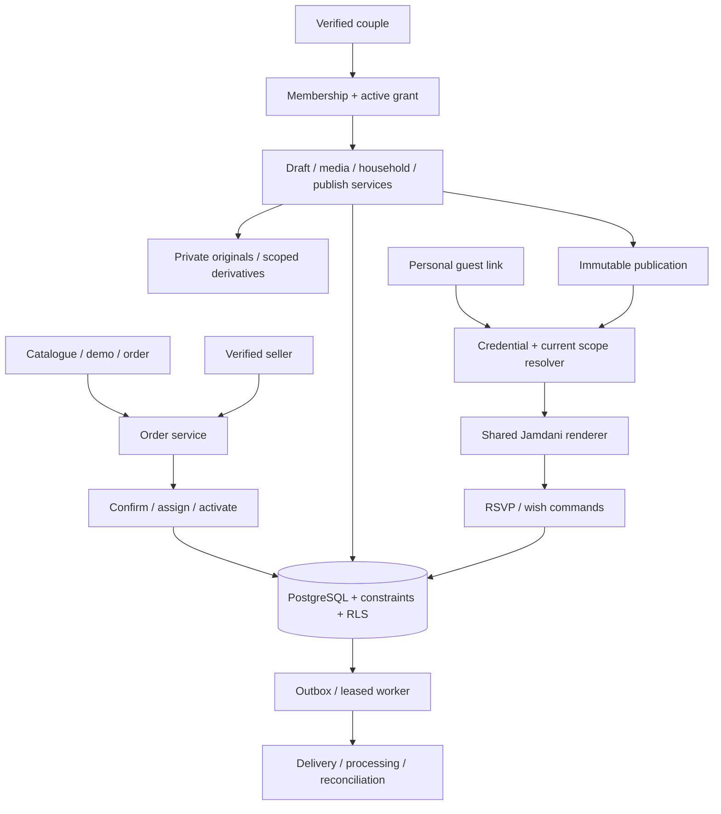

# System architecture — Client V1

**21 October zero-spend execution update:** [Free-first plan](docs/plans/free-first-product-delivery-2026-10-21.md) governs the next batches. Target four bounded surface applications in one repository; exact-app Netlify Free compatibility first, retaining the current personal Vercel preview until a qualified cutover. One multi-tenant backend per environment; no per-wedding infrastructure, paid dependency or automatic tier change. New origin configuration, separate session transports, minimal media authority and old-link compatibility are required work, not implemented capabilities.

**21 October topology review:** the current personal Vercel deployment is still one application/origin. [Audience and origin separation proposal](docs/design/surface-separation-review-2026-10-21.md) recommends distinct storefront/client/guest/operator applications in one repository, retaining shared pure contracts/renderer and tenant-secured backend. It qualifies the older “one modular app” default below; the split has not been implemented. Current delivery status is in the [hardening evidence](docs/build-evidence/client-pilot-hardening-2026-10-21.md).

Updated: **21 October 2026**. Backend/auth/RLS, seller transactions, publication, named guest delivery and [private media](docs/build-evidence/media-bangla-first.md) are implemented. Seven migrations and four normal-role proofs pass on Dawat Staging. Vercel personal preview has actual customer OTP, upload/publish/guest/revoke evidence; intended seller bootstrap/MFA, new free-host qualification, physical devices and operations/recovery remain pending. Bangla is primary, English secondary. Claims/outbox automation remain target work. Scope: [plan](plan.md). Entities/commands: [data/API](docs/specs/client-v1-data-api.md).

## 1. System shape

Implemented workflow supersedes the earlier correction/export target status: the seven-migration history includes attributed `correct_response`, bounded transactional `export_households`, tenant-only `workspace_overview` and idempotent `set_invitation_visibility`. Management commands retain order → wedding → household lock ordering; guest writes share the wedding lock. CSV is generated on demand behind session/RLS, no public export object. Autosave acknowledges captured snapshots and never replaces newer local typing; failed/ambiguous writes pause automatic retry, and conflict resolution requires deliberate overwrite. SMTP receipt, hosted customer sign-in, media pipeline and personal HTTPS preview are verified; seller/operations and the proposed free-host cutover remain pending. [Evidence](docs/build-evidence/client-dashboard-workflow.md).

Current deployment uses one modular Next.js app, PostgreSQL and managed storage/auth. The next plan extracts four bounded surface apps in one repository, sharing pure contracts and a versioned invitation renderer. Do not create a project/deployment or duplicated card for each couple/guest.



Gift opening is presentation. Tenant policies, guest credentials and server-side filtering are access control. An unopened cover cannot protect content already sent to an unauthorized browser.

## 2. Stack and migration

| Layer             | Decision                                                                       | Boundary                                                                            |
| ----------------- | ------------------------------------------------------------------------------ | ----------------------------------------------------------------------------------- |
| Web               | Existing Next App Router, React, TypeScript strict                             | Preserve pinned versions pending separate supported-version/security review         |
| Runtime/tooling   | Keep npm lockfile; pin compatible supported runtime in CI                      | Current local Node22.18.0/npm10.9.3; deployment patch/version review remains a task |
| UI                | Existing CSS modules + shared tokens, selected accessible primitives if needed | Original design; no mandatory Tailwind/shadcn migration                             |
| Forms/locales     | Existing RHF + Zod, Intl and explicit BN/EN dictionaries                       | Shared structural schemas; authoritative server policy                              |
| Database          | Supabase PostgreSQL + SQL migrations/generated types                           | Constraints, RLS, transactions; no extra ORM initially                              |
| Customer identity | Supabase Auth verified email/session                                           | Guests need no account; seller additionally needs MFA and controlled staff role     |
| Media             | Supabase Storage + bounded image processing                                    | Private originals, scoped derivatives and provenance                                |
| Jobs              | PostgreSQL outbox + bounded authenticated worker                               | Leases, retries, dead letters; no second queue initially                            |
| Providers         | Small auth/email/payment adapters                                              | Gateway integration only after sandbox/merchant readiness                           |
| Hosting           | Server-capable commercial deployment + isolated staging/backend                | Vercel/Supabase proposed; tier/region/cost/quotas reviewed before provisioning      |
| Verification      | Vitest, SQL/integration tests, supported browser E2E                           | Security and transaction tests, real-device evidence                                |

`next.config.ts` now uses server deployment; `output: 'export'` has been removed. Request-dependent cookies, authenticated handlers and wedding resolution are implemented. Static samples remain deliberate demos. [Next export limitations](https://nextjs.org/docs/app/guides/static-exports).

Use current [Supabase server-client guidance](https://supabase.com/docs/guides/auth/server-side/creating-a-client?queryGroups=framework&framework=nextjs). Do not treat browser-supplied user IDs or unchecked cookies as verified identity. No tool/version migration solely because an older planning file preferred another stack.

## 3. Routes and audiences

| Route family                                         | Audience / rule                                                                     |
| ---------------------------------------------------- | ----------------------------------------------------------------------------------- |
| `/`, `/templates/jamdani`, `/order`, `/order/status` | Public demos/limited preview/order; own status needs scoped authentication/claim    |
| `/auth/*`, `/claim/[token]`                          | Intended verified account; safe return paths; GET never consumes claim              |
| `/dashboard`                                         | Signed-in customer; list accessible weddings or show pending/locked state           |
| `/weddings/[id]/*`                                   | Active customer: overview, invitation, guests, responses, wishes, sharing, settings |
| `/admin/orders/*`, `/admin/weddings/*`               | Controlled staff role, action policy and audit                                      |
| `/preview/[opaque-id]`                               | Authorized, noindex/no-store/read-only; no management credential                    |
| `/i/[slug]`                                          | General-safe published content, no response writes                                  |
| `/i/[slug]/g/[token]`                                | Named household, filtered published content and own response                        |
| `/api/*`                                             | Independently authorized commands/queries; server rendering calls services directly |

Legacy `/invite/`, `/studio/`, `/operator/` are prototype routes. Preserve sample review during migration; remove demo operator bypasses from production.

## 4. Identity and tenant isolation

Management requires **verified session + wedding membership + confirmed order/valid entitlement + active dashboard grant**. Enforce on each service call, direct database policy and private object read. Staff roles are server-controlled; sensitive actions require recent verified authentication/audit.

Enable RLS with least-privilege grants for exposed tables. Customer policies check membership and current grant; mutable tables need both `USING` and `WITH CHECK`. Prevent self-elevation through membership/grant/profile writes. Test normal anonymous/authenticated database roles, not only service-role calls. [RLS/grants](https://supabase.com/docs/guides/database/postgres/row-level-security).

Tenant children carry `wedding_id`; composite foreign keys prevent referencing an event/household/media ID in another wedding. Scope every query by tenant and resource. Storage policies enforce the same relationship; knowing a path is insufficient. [Storage policies](https://supabase.com/docs/guides/storage/security/access-control).

Customer requests use user-scoped DB access. Elevated guest/admin commands are narrow server-only transactions: verify current actor/credential/state, restrict function execution, fix `search_path`, fully qualify tables. Never expose a generic service-role endpoint. Avoid recursive membership RLS policies through carefully restricted helper functions.

V1: one primary customer owner per wedding; multiple separately scoped weddings per account. Family collaborators are later, rather than sharing credentials. Distinct URLs alone do not authorize access.

## 5. Independent state axes

| Axis                 | States / meaning                                                                         |
| -------------------- | ---------------------------------------------------------------------------------------- |
| Order                | requested / reviewing / confirmed / cancelled — commercial agreement                     |
| Payment              | pending / manually_verified / provider_verified / failed / refunded — financial evidence |
| Management grant     | inactive / active / suspended / revoked — customer management access                     |
| Content              | mutable draft revision / immutable published version                                     |
| Guest visibility     | unpublished / live / paused / expired / archived                                         |
| RSVP                 | open/closed, deadline, policy revision                                                   |
| Household credential | active / revoked / rotated                                                               |
| Delivery             | queued / sent / failed — email failure does not undo activation                          |

Suspending management does not implicitly unpublish. Pausing guests is a separate explicit action with an impact preview. Refunds record financial events plus reviewed entitlement actions; delayed provider messages must not silently delete customer weddings. Term/retention remains a business decision, not lifetime hosting by default.

## 6. Data authority and renderer

- `weddings`: tenant, immutable ID, stable slug, live-version pointer and lifecycle.
- Draft: structured content + schema version + expected revision. Publication: immutable validated snapshot with pinned template version and ready media IDs.
- `event_keys`: stable wedding-scoped IDs. Date/title/venue remain in versioned content. Operational access/policy/response rows refer to IDs, not another editable copy of event facts.
- Households: named identity/personalization; `household_events`: permitted event IDs and allowances, resolved against current publication.
- Responses/wishes: private operational data, never public publication JSON.
- Shared renderer context: `demo | draftPreview | householdPreview | liveGeneral | liveHousehold`; server authority determines context, not client query flags.

Build public DTOs by allowlisting. Filter restricted events **before** HTML/JSON, metadata, countdown, calendar and media serialization. General links have an explicit general-visible event list; never default to all events. A household with no valid published events gets an update-needed/unavailable state, not a broader fallback card.

## 7. Atomic commands

### Confirm/provision/activate

Lock order → verify staff and financial eligibility/explicit exception → enforce one wedding per order → confirm/provision once. Activation separately binds intended verified customer/claim, updates grant and queues delivery transactionally. Unique keys/idempotency prevent duplicate workspaces. A completed retry returns original result.

### Save draft

Authorize → validate bounded draft shape → compare `expectedRevision` → update/increment → acknowledge. Incomplete publish fields allowed. Client allows one in-flight save, coalesces later changes, and never marks newer unsent edits saved from an older acknowledgment. `409` retains local edits and offers server-version comparison; no silent last-write-wins.

### Publish

Authorize/lock wedding, entitlement and draft → check expected revision, term, template/media/content → create immutable version → switch pointer/revisions atomically → set first-publish term start once → enqueue OG/invalidation → commit. Failures before commit keep previous live version; nonessential delivery failure retries afterward.

Publish, household policy and RSVP commands use consistent lock order (wedding → household/policy → response/idempotency). Recheck removed events, lowered allowances and deadlines while holding relevant locks. Reject changes that invalidate existing confirmations without explicit reconciliation. Bulk destructive edits cannot silently erase response history.

### RSVP/wishes

Resolve active guest credential/session; recheck publication visibility, term, event scope, policy/deadline and response revision in transaction. Accept integer non-negative counts, total within allowance; decline requires zero. Claim idempotency key bound to household/action/body hash. Same key/body returns original result; same key/different body conflicts. Atomically update allowed event response set and return confirmed records/revision. Concurrent distinct edits require current revision; one wins, one conflicts.

For multi-event consistency, `expectedResponseRevision` compares the household's aggregate answer-set revision, not an arbitrary event row. Guest commands also compare the wedding's aggregate RSVP policy revision and the household overlay revision; these have distinct ownership defined in the data/API contract. Host corrections increment the same aggregate response revision.

Wishes have their own idempotent command and never change attendance. Identity comes only from credential scope. Manual host responses use the same validation plus actor/source/reason; deadline override is a separate privileged command.

## 8. Guest credentials

Generate at least 32 random bytes per token. Store digest for verification and authenticated-encrypted ciphertext solely for owner recopy. Use dedicated versioned server key, identity-bound associated data and independent key backup/rotation. Copy returns no-store data without rotating; explicit rotation invalidates old scope/sessions and preserves household/history.

Initial personal URL validates and exchanges into a short-lived scoped guest session; remove raw token from later visible navigation where feasible. Session design must support several households/weddings in one browser: explicit wedding/household-scoped requests, no global current-guest collision. Recheck credential revocation on subsequent requests.

Implemented route: `/i/:slug/g/:token` renders a generic exchange shell; a POST creates a 12-hour session, then `location.replace` navigates to `/i/:slug/h/:householdId/`. The HttpOnly session cookie is scoped to that household path, including its `/api/` endpoint. Database digest, active credential revision, expiry, publication, entitlement and allowed published events are rechecked on reads/writes. Owner copy recovers the same AES-256-GCM encrypted token; explicit rotation/revocation invalidates all earlier sessions without deleting replies. Hosted and offline environments have separate, ignored key rings that need independent secure backup before real data intake.

HTTPS, secure cookie flags, appropriate SameSite/HttpOnly, origin/CSRF checks, noindex, `Referrer-Policy: no-referrer`; no third-party guest analytics/session replay by default. Redact token paths/signed URLs/emails/wish bodies from app/hosting/error logs. GET/crawlers do not consume claims or submit replies.

A forwarded link carries household bearer access; it does not verify individual identity. Revocation prevents future authorized requests, not screenshots or already downloaded files. Explain residual signed-media validity rather than promising remote erasure.

## 9. Media and caches

Reservation scoped to wedding → bounded upload → actual decode/format/dimension checks → orientation/metadata cleanup → responsive derivatives → ready/rejected. Publish only ready approved media. Maximum five photos; proposed initial limits 10MB/20MP each, JPEG/PNG/WebP, validated against processing budgets. Unsupported HEIC gets an actionable conversion message until support is qualified. Never silently drop a sixth photo.

Implemented: raw image body enters a trusted Next Node processor after owner/RLS authorization and a shared database lease. Buffer ≤10 MiB/30s; real sharp decode ≤20MP; 480/960/1600 WebP outputs, EXIF auto-orientation and metadata removal. Originals are discarded from bounded memory. Maximum four shared leases, one native decoder per process, four attempts per reservation, same-file SHA256 binding and 2-minute crash recovery. Ready commits only after all scoped objects exist; uncertain acknowledgments retain possibly committed data. Five live slots include unexpired unfinished reservations; initial daily/history quotas bound abuse/storage.

Storage bucket `wedding-media` is private with restrictive denial to anon/authenticated even under unrelated permissive policies. `SUPABASE_MEDIA_SECRET_KEY` is confined to the Storage processor; ordinary auth/owner/guest queries retain session RLS. Authorized image proxies recheck current publication/guest session and media references on every request and return private/no-store WebP. No bearer signed Storage URLs are exposed. Therefore revocation blocks future proxy reads, while downloaded bytes/screenshots remain beyond recall. Draft/publication triggers enforce ready same-wedding references; immutable publication-media rows pin removed library photos. Delayed orphan cleanup is bounded and implemented as a command; job scheduling, retention policy and restore/load/phone qualification remain pending.

Private originals and restricted derivatives need protected reads/short-lived URLs. General-safe published art/derivatives may use versioned public paths; anything public is deliberately shareable and not instantly recallable. Cleanup checks all retained publication references; abandoned uploads use delayed orphan cleanup.

| Data                                                                     | Cache rule                                               |
| ------------------------------------------------------------------------ | -------------------------------------------------------- |
| Versioned theme art                                                      | Immutable public caching                                 |
| General-safe publication                                                 | Revision-keyed; visibility/expiry checked before serving |
| Personalized HTML/DTO, draft, management, responses, exports, claim/copy | Private/no-store; no cross-household cache               |
| Signed media URLs                                                        | Scoped/short-lived; remaining validity explained         |

No private service-worker/offline caching in V1. Dirty edits remain visible in memory on network failure; any local recovery is explicitly scoped, cleared on sign-out and excludes wholesale sensitive DTO copies.

## 10. Jobs, performance and recovery

Outbox commits with activation/publish/payment. Worker claims leased batches atomically, bounds work/concurrency, uses backoff/jitter and deduplicated provider operations; expose dead letters/backlog. No unawaited post-response work. Processing beyond host limits moves to a worker rather than forcing every domain into microservices.

Separate local/staging/production DBs, buckets and keys. Measure nearby app/database region latency from Bangladesh. Migrations use expand/migrate/contract to preserve rollback compatibility. No production demo-seed fallback. Readiness covers DB, critical assets and queue health.

Proposed budgets, not current guarantees: critical guest transfer ≤1MB, compressed guest JS ≤200KiB, mobile LCP ≤2.5s, CLS ≤0.1, field INP ≤200ms; RSVP server-processing p95 ≤700ms under recorded load. Measure deferred photos/audio and network latency separately. Paginate lists; authoritative counts use indexed server queries. Initially refresh on foreground/focus, manual action and bounded ~30s foreground polling with backoff; realtime is optional later.

Record egress/storage/DB/processing/auth/email/support cost per order and alerts. Proposed recovery RPO ≤1h/RTO ≤4h needs funded backup cadence/PITR plus tested objects/keys/config restore; database-only backup is insufficient. Revise objectives explicitly if operating budget cannot meet them.

## 11. Code organization

```text
web/src/
  app/                  public, auth, admin, weddings, guest, API
  features/
    orders/ access/ weddings/ editor/ publishing/
    households/ responses/ wishes/ media/
  invitation/           schema, renderer, theme manifest, fixtures
  components/           accessible shared UI, no DB policy
  server/               auth, focused services, providers, jobs
  i18n/                 bn/en copy and formatting
web/supabase/
  migrations/ tests/ seed/
```

Target organization, not completed refactor. Extract existing behavior gradually, preserve tests, use generated types/explicit DTOs and ordinary focused functions. No mandatory CSS framework, package-manager migration, generic repository factory or global state dependency. Detailed decisions: [register](docs/decisions.md). Acceptance: [corner cases](docs/qa/client-v1-corner-cases.md) and [release](docs/qa/client-v1-release.md).
