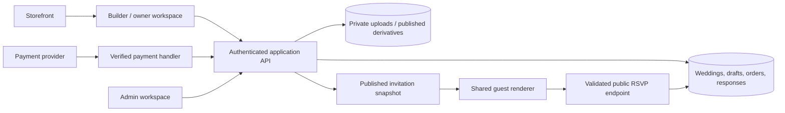

# Product and technical blueprint

> First-pass proposal, retained as background. Current authoritative architecture/design/scope and detailed contracts are linked from [the master README](../README.md). Resolve any phase-label difference using the current plan, not this historical proposal.

Everything in this file is a **proposal for the new product**. It is not a reconstruction of either reference's source code, hosting stack or database. The user has selected The Digital Yes as the main creative inspiration and e-Nimontron as a useful local reference.

## 1. Product definition

Build a Bangladesh-first wedding invitation platform where a couple or family can choose an original desi theme, enter their wedding details, preview a polished invitation, publish it and manage responses. Offer design assistance for customers who want someone else to prepare it.

The product has four connected surfaces:

1. **Storefront:** explains the service and sells themes/packages.
2. **Builder and owner dashboard:** creates, saves, publishes and manages an invitation.
3. **Guest invitation:** the mobile experience opened from a shared link.
4. **Admin workspace:** templates, orders, support and fulfilment.

An animated card is the visible outcome. The publishing, guest-response and support systems make it a complete service.

## 2. Audience and service model

Primary audience: Bangladeshi couples and the relatives arranging invitations, including families abroad who need Bangla/English sharing.

| Mode | Customer action | Our responsibility |
|---|---|---|
| DIY template | Choose theme, enter content, preview, pay and publish | Reliable builder, hosting, responses and support |
| Assisted template | Send details and review a proof | Enter content, check layout, make agreed changes |
| Bespoke design | Approve a scoped quote and design brief | Original illustration/layout with defined deliverables and revisions |

Start with DIY plus a simple assisted-request path. Bespoke work can initially be fulfilled manually through the same invitation renderer. This avoids building a complex studio-management system before the core product works.

## 3. Desi identity and visual system

Use the references' care in presentation, clear demos and sense of occasion. Develop a separate brand and visual language.

### Storefront direction

- Warm paper/ivory background, deep ink text, restrained burgundy/emerald accents.
- Editorial scale for headings, comfortable reading size for practical information.
- One consistent Bangla/Latin typography system for navigation and forms.
- Theme previews as the main visual content, with space around them.
- Mobile CTAs close to the preview, clear inclusions and a visible final price.
- Small decorative details rather than decorations behind every form field.
- Show actual demos. Avoid fabricated ratings, customer counts or countdown scarcity.

### Theme direction

Launch concepts are described in [the catalogue](02-template-catalogue.md): Jamdani Ivory, Holud Utsab, Royal Nikah, Lal–Shada Biye, Mughal Garden and Modern Desi.

Each theme needs:

| Asset / behavior | Production requirement |
|---|---|
| Cover | Original composition and opening state |
| Background | Optimized image/texture, with readable content surface |
| Decorative layers | Independently positioned flowers/textiles/arches where useful |
| Motifs/icons | Consistent event, date, venue and contact visuals |
| Typography | Licensed Bangla/Latin fonts; proper conjunct shaping and fallback |
| Palettes | A few tested choices with usable contrast |
| Portrait area | Optional couple photo/illustration; graceful photo-free layout |
| Motion | One memorable opening; restrained section transitions |
| Quiet version | Full experience with reduced motion and no required audio |
| Preview media | Thumbnail and short demo poster/video where justified |

Do not split Bangla words into animated individual Unicode characters. Animate a complete shaped word or line; test conjuncts, long names and mixed scripts. Do not animate sacred text as a scratch-game target. Religious and cultural motifs must be explicit owner choices rather than assumptions based on names.

### Invitation opening

```text
Light initial page / useful fallback
→ guest taps Open invitation
→ brief envelope/door/paper transition
→ names + invitation wording
→ event cards and practical information
→ RSVP and private note
```

Provide Skip animation / View details. Never hide the venue behind an animation that can fail. Sound may be blocked until the visitor interacts, so start music following the opening gesture, catch playback failures and retain a visible mute control. [MDN autoplay guidance](https://developer.mozilla.org/en-US/docs/Web/Media/Guides/Autoplay).

Respect the device's reduced-motion preference and offer a calm alternative. [MDN reduced-motion reference](https://developer.mozilla.org/en-US/docs/Web/CSS/Reference/At-rules/@media/prefers-reduced-motion).

## 4. Information architecture

These are suggested routes, not currently implemented files.

| Surface | Routes | Main purpose |
|---|---|---|
| Public | `/`, `/templates`, `/templates/{slug}` | Discover, filter and try designs |
| Public | `/pricing`, `/how-it-works`, `/custom-design`, `/contact` | Understand options and get assistance |
| Public | `/terms`, `/privacy`, `/refunds` | Actual service/hosting/data policies |
| Account | `/login`, `/account` | Sign-in, account and owned weddings |
| Owner | `/dashboard` | Draft/live invitations and next actions |
| Builder | `/weddings/{id}/edit` | Structured content, style, sections and preview |
| Owner | `/weddings/{id}/guests`, `/responses` | Households, responses and totals |
| Owner | `/weddings/{id}/share`, `/settings`, `/orders` | Links/QR, privacy, lifecycle and receipts |
| Private preview | `/preview/{opaque-token}` | Expiring read-only proof, excluded from indexing |
| Guest | `/i/{slug}` | Published invitation only |
| Guest, later | `/i/{slug}/g/{opaque-token}` | Household-specific greeting and permitted events |
| Admin | `/admin/templates`, `/orders`, `/customers`, `/requests` | Operate the service |
| Later | `/save-the-date`, `/guides`, `/reviews` | Adjacent products and supporting content |

Keep `/admin/...` routes under the admin namespace, even when the abbreviated labels above omit the prefix. Admin protection must happen on the server, not just by hiding links.

### Proposed homepage sequence

Hero with original interactive preview → choose by occasion → featured themes → three-step process → guest features → local/Bangla benefits → package/inclusions → custom-design help → real reviews when available → FAQ → contact/policies.

### Product page

Theme title, category, price/inclusions, playable demo, mobile/full-screen option, supported sections, language/photography choices, hosting term, customization limits, related themes and Start with this theme. Clearly label demo data and disable production RSVP submission in demos.

## 5. Builder specification

Use a guided form and structured sections for the first release. Avoid a freeform graphics editor initially: arbitrary text placement, font sizing and drag/drop across screen sizes greatly increases complexity.

Desktop: section navigation, form panel and preview. Mobile: full-width form steps with a Preview action. Provide Back/Next, required-field validation, a persistent save-status indicator and undo of the most recent accidental edit where practical.

### Step 1 — occasion and theme

Wedding suite or Save the Date type; theme; Bangla/English/bilingual choice; photo or illustration-led presentation. Save the Date can remain a later product type while using the same content engine.

### Step 2 — people and hosts

| Field | Rule |
|---|---|
| Partner display names | Required; each locale may have different text |
| Full names / nicknames | Optional separate values; never derive one by truncating |
| Display order | Owner chooses partner order |
| Parents / family / hosts | Repeating name + relationship or free host wording |
| Invitation wording | Curated Bangla/English starters with editing |
| Opening blessing | Optional; allow a neutral invitation |
| Contact people | Explicitly choose which contact details appear to guests |

Support families who do not want both parents listed, have multiple hosts, or prefer a single family invitation line. Do not force every wedding into father/mother columns.

### Step 3 — one or more events

Event types: engagement, mehendi, gaye holud, nikah/akd, biye, walima, reception, or custom label. Do not require all of them.

Each event stores:

- Localized title and short description.
- Start/end date and time, with timezone default **Asia/Dhaka**.
- Venue, complete address, useful landmark and directions URL.
- Optional dress code, arrival/meal/ceremony notes and host contact.
- RSVP enabled/disabled, deadline and attendance scope.
- Order in the invitation and visibility status.

Allow a wedding spanning multiple dates. The countdown points at a selected event, not an arbitrary first array item. Store the timezone and actual timestamps, not a formatted date string alone. Optional Bengali calendar display must be verified separately before implementation; it is not required for MVP.

### Step 4 — photographs and soundtrack

Start with up to five optimized photos, reorder/crop/remove controls and descriptive alt text. Keep original uploads private; publish only approved derivatives. Offer a small licensed music library and a no-music choice. Uploading arbitrary tracks can wait until rights, size limits and processing are handled.

### Step 5 — sections and style

Toggle/reorder allowed sections using Move up/Move down as well as drag handles. Style controls should be safe choices: palette, approved font pairing, opening style and optional photograph. Hide empty optional sections automatically.

Possible blocks: opening, couple/hosts, message, countdown, event list, gallery, dress code, contact, FAQ, RSVP and closing. Transport, stays, story timeline, gift information and more blocks can follow later.

### Step 6 — RSVP setup

- Require guest name; allow optional contact only when there is a clear purpose.
- Enable response per event.
- Ask adults/children with explicit labels and calculate total.
- Set open-response vs household-invite mode.
- Set allowed headcount and deadline; enforce on server.
- Optional private note, with length limits.
- Later: dietary needs and event-specific access.

Use neutral response labels such as “আসতে পারব / আসতে পারব না” alongside English equivalents. Do not force a guest to provide an email account or install an app to answer.

### Step 7 — preview and review

Mobile/desktop view; full guest view; image and translation warnings; missing event details; final URL/slug; privacy settings; plan/inclusions and publishing confirmation. Preview must use the same renderer as the live invitation.

### Step 8 — payment and publishing

For DIY: save draft → price quote → payment → server verification → publish. For assisted work: quote/order → brief → fulfilment → proof → approval → publish. Both paths produce the same kind of published invitation.

## 6. Guest invitation content order

1. Optional cover/opening, language control and music toggle.
2. Names, family/host wording and blessing/message.
3. Main date and countdown.
4. Event cards with date/time, venue, map and calendar action.
5. Optional gallery/story.
6. Dress code, helpful notes and selected host contacts.
7. RSVP form and optional private note.
8. Clear confirmation/edit-response path and closing.

Make event details reachable immediately. Distinguish a past event from a cancelled event. If all events have passed, show a thank-you state rather than negative countdown numbers.

Calendar exports must include the selected event's timezone and correct start/end; opening a map should not require granting geolocation. Add familiar landmarks because a venue pin alone may not be enough.

## 7. Owner and admin dashboards

| Owner screen | Contents |
|---|---|
| Overview | Draft/live state, theme, event dates, publishing action, RSVP summary |
| Edit | Content, locales, images, music and sections |
| Guests | Household names, allowance, event invitation scope; import later |
| Responses | Per-event accepted/declined/pending totals, adult/child counts, private messages |
| Share | Stable URL, copy link, WhatsApp share text, QR download |
| Orders | Itemized purchase, receipt and actual payment status |
| Settings | Slug, privacy, RSVP deadline, unpublish, archive and data export/delete |
| Design requests, P2 | Brief, proof, consolidated revision comments and approval |

Do not equate a page view with a confirmed guest. Link-preview bots can inflate views; pending guests exist only when there is a defined guest list.

| Admin screen | Minimum responsibilities |
|---|---|
| Templates | Metadata, tags, assets, supported blocks, schema/template version, enable/disable |
| Orders | Payment events, state, fulfilment status, support context and receipt |
| Customers/weddings | Locate an issue with permission-scoped access |
| Design requests | Quote, assigned owner, required materials, proof and included rounds |
| Content | FAQs, package copy and translations from one maintained source |
| Operations | Failed uploads, unsuccessful publishing, payment exceptions and delivery jobs |
| Audit | Who changed prices, published a design, adjusted payment or accessed support data |

Separate payment state from fulfilment state. An order can be paid while design work is still awaiting materials.

## 8. Pricing and service decisions

Do not convert European prices into a Bangladesh pricing policy. Competitor offers are reference points, not evidence of our customers' willingness to pay.

Proposed starting structure:

| Product | Scope | Pricing method |
|---|---|---|
| DIY invitation | Approved theme, defined photo/event limits, Bangla/English, RSVP, stated hosting term | One published fixed price |
| Assisted setup | DIY scope plus content preparation and one consolidated revision | Separate setup fee or package |
| Bespoke design | Written artwork/layout brief, named deliverables, limited rounds and timeline | Quote |
| Later add-ons | Extra artwork, custom domain or print package | Itemized, explicit price |

Before publishing a price, calculate payment fees, media/hosting, support time, design effort, expected revisions and margin. Choose a finite stated hosting period, for example a proposed 12-month term with a clear renewal/archive option; this is a product hypothesis, not a market finding. Define expiry reminders and access/export behavior before collecting payment. Avoid an undefined lifetime-hosting promise.

Maintain package prices, limits and inclusions in a single server-side catalogue. Marketing and checkout read the same data. Preserve the purchased entitlement snapshot on each order so future price changes do not rewrite old orders.

## 9. Suggested implementation architecture

One practical independent-development option is **TypeScript + React/Next.js**, PostgreSQL, managed authentication and object storage. A managed backend such as Supabase can reduce account/database work; tenant authorization still needs explicit policies. This is a proposed stack, not a requirement or a claim about the reference sites. [Next.js App Router documentation](https://nextjs.org/docs/app), [Supabase row-level security](https://supabase.com/docs/guides/database/postgres/row-level-security).

Use ordinary HTML/CSS and small animation components for the invitation. A shared renderer with structured content is more important than the framework choice. CSS transforms and layered images can handle an opening without requiring a heavy 3D engine. Decide on specialized 3D tooling only when the scene demands it.



A guest request must never receive the owner's entire wedding workspace. Fetch a restricted published payload. Restricted household/event content needs server-side authorization and cache isolation, not merely hidden frontend sections.

### Template engine contract

Separate:

- **Content:** names, localized wording, events, image references and section data.
- **Theme:** palette tokens, font pairing, decorative assets and block layout.
- **Behavior:** opening, audio, countdown, gallery, maps/calendar and RSVP.
- **Entitlements:** paid plan limits, publishing rights and hosting term.

Illustrative content shape:

```json
{
  "schemaVersion": 1,
  "templateId": "jamdani-ivory",
  "templateVersion": 1,
  "locales": ["bn", "en"],
  "timezone": "Asia/Dhaka",
  "couple": {"partner1": {"bn": "নাম", "en": "Name"}},
  "events": [
    {"id": "event_1", "type": "nikah", "startAt": "2027-01-15T19:00:00+06:00"}
  ],
  "sections": ["opening", "hosts", "events", "gallery", "rsvp"],
  "theme": {"palette": "ivory-gold", "opening": "paper-envelope"}
}
```

This is a shortened example, not a complete schema. Validate all content at the API boundary. Pin template versions to published invitations so a theme update cannot silently break existing customers.

### Proposed data model

| Entity | Important fields / relationships |
|---|---|
| users | Authentication identity, profile and locale |
| weddings | Owner, title, slug, timezone, draft/published IDs, lifecycle dates |
| wedding_members | Wedding, user, role; P2 collaborators |
| templates | Slug, category, tags, active status and current version |
| template_versions | Version, schema, asset references and capability flags |
| invitation_versions | Wedding, content JSON, template version, draft/published marker, timestamp |
| events | Wedding/version, stable event ID, times, venue and localized fields |
| media | Wedding owner, object key, type, size, processing status and derivative keys |
| households | Wedding, display name, allowance and hashed access token |
| guest_event_invites | Household/event, permitted headcount and access scope |
| responses | Wedding, household/receipt token, event, attendance, counts and updated time |
| wishes | Wedding, author name, private message, optional future media reference |
| orders | Owner/wedding, price/entitlement snapshot, currency, total and status |
| payment_events | Provider reference, verified amount/currency, event ID and processing state |
| design_requests | Order, brief, proof/version, rounds and fulfilment status |
| audit_events | Actor, action, target and timestamp |

Names and small layouts can live in versioned JSON, while searchable operational data stays relational. Decide whether event details are authoritative in normalized tables or invitation JSON; do not maintain conflicting editable copies. Published snapshots may denormalize data intentionally.

### Lifecycle and publishing

```text
Invitation: draft → ready → published → archived/expired
                       ↑        ↓
                    updated draft → republish

Payment: initiated → pending → verified-paid
                         ↘ failed / cancelled

Assisted fulfilment: awaiting materials → in design → proof
                    → revisions / approved → published
```

Publication creates a validated immutable snapshot and updates the active pointer atomically. Editing creates/updates a draft without replacing the live invitation until republished. Keep the stable guest URL. Preserve RSVP records across content changes through stable event IDs; removing an event with responses requires a deliberate archive/migration behavior.

### Payment integration

For Bangladesh, evaluate an approved local gateway such as SSLCOMMERZ against its current merchant onboarding and supported methods. The developer portal is a starting point, not confirmation that a merchant account or every desired method is available. [Official developer portal](https://developer.sslcommerz.com/).

Implementation rules:

1. Calculate price and entitlements on the server.
2. Create a pending order with a unique reference before redirecting.
3. Verify payment through the provider's documented server-side process; check merchant/order reference, amount, currency and final status.
4. Process repeated callbacks idempotently using a unique provider event/transaction identifier.
5. Grant publishing entitlement only once verification succeeds.
6. Treat browser success/cancel redirects as navigation, not proof of payment.
7. Show a recoverable pending state if confirmation is delayed.
8. Reconcile transactions and surface exceptions for admin support.

Use sandbox credentials and fictional data during development. A screenshot or typed transaction ID is not an automatic payment verifier. If a manual payment option is launched, label it as pending review and provide a real reconciliation process.

### Proposed API boundary

| Operation | Required behavior |
|---|---|
| List active templates | Public metadata and safe demo content only |
| Create/read/update draft | Authenticated wedding ownership; optimistic version check |
| Request upload | Authorized wedding, type/size limits and private destination |
| Read preview | Owner session or expiring read-only token |
| Quote / create order | Server package/price calculation and immutable order snapshot |
| Payment confirmation | Verified provider event; replay-safe processing |
| Publish / unpublish | Owner entitlement and content validation |
| Read guest invitation | Published fields only; guest-access rules applied server-side |
| Submit/update RSVP | Allowed event, deadline, counts, rate limits and receipt token |
| Read/export responses | Owner/admin authorization; no public guest-list endpoint |
| Admin fulfilment | Separate role checks and audit trail |

## 10. Reliability, privacy and practical constraints

| Concern | Required design |
|---|---|
| Draft loss | Visible save status, retries, server draft and optimistic concurrency |
| Preview mismatch | Shared renderer; no separate hand-maintained preview HTML |
| Tenant data | Ownership checks for every record/object; database-level protection where appropriate |
| Guest privacy | Unlisted invitations by default; no public guest list; optional invitation access control later |
| URL privacy | Do not put contacts, dietary notes or family data in query strings; use opaque tokens |
| Token leakage | No unnecessary third-party analytics on token-bearing pages; restrictive referrer policy; hash access tokens at rest |
| Uploads | Type/size checks, decode/re-encode images, remove metadata, private originals and scoped downloads |
| User text | Escape output; no arbitrary script/HTML editor in MVP |
| RSVP duplication | Idempotency/receipt tokens; update existing response rather than multiplying it |
| Open RSVP | Explain that forwarded links can produce unlisted respondents; use invitation-only mode where enforcement is needed |
| Household RSVP | Enforce allowance and permitted events on the server; revocable tokens |
| Bot submissions | Server rate limits, honeypot and abuse checks; add challenges only if needed |
| Export | Protect CSV from formula injection; authorize every export |
| Audio | Licensed tracks, clear mute, graceful playback failure |
| Low-bandwidth phones | Small initial cover, lazy gallery/audio and restrained effects |
| Accessibility | Keyboard opening, form labels, contrast, error messages and reduced motion |
| Localization | Separate localized content; no auto-translating personal names without review |
| Backup/recovery | Database backups, published-version recovery and payment event reconciliation |
| Support | Real contact path and recoverable publish/payment failure messages |
| Retention | State draft/media/RSVP retention, expiry, export and deletion behavior before launch |

An unlisted URL or `noindex` reduces discovery; it is not access control. A QR code is another way to carry the link; it does not make an invitation private.

## 11. Proposed launch acceptance targets

These are development targets, not measurements of either reference:

- Useful invitation content works at 360 px width with no horizontal overflow; include 320 px and large text checks before launch.
- Long Bangla names and optional/no photographs work in every launch theme.
- Missing/failed music and decoration do not block venue details or RSVP.
- Design the initial non-gallery transfer around a 1 MB budget; measure before setting a final performance gate.
- Test actual iPhone/Android browsers and common in-app sharing browsers when devices are available; a desktop phone frame alone is not device testing.
- A completed end-to-end sandbox purchase publishes one invitation and collects one response visible only to its owner.
- A failed payment never unlocks paid publishing; a duplicate callback does not duplicate access or orders.
- Published content survives refresh; draft edits do not unexpectedly change the live card.

## 12. Choices to resolve before implementation

The specification uses working defaults so development planning can continue. Before final product design, settle the brand/domain, launch language order, customer DIY vs assisted emphasis, fixed price/hosting term, merchant gateway approval and ownership/licensing of theme assets. These decisions are not prerequisites to completing this research pack, but should be explicit before paid launch.
