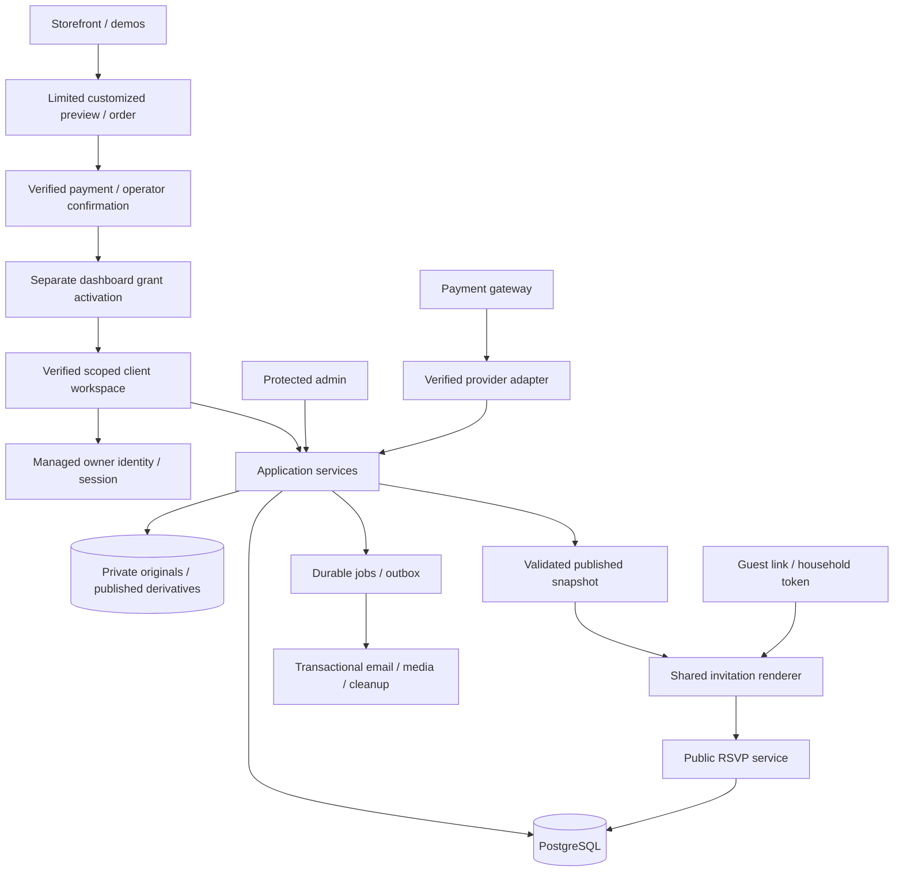

# Architecture

**v6.4:** scoped invitation-entry CSS isolates the guest main from storefront layout. `useInvitationMusic` owns the audio ref, play-promise generation guard, per-scope on/off preference and pause/error/visibility cleanup, including delayed mounting after workspace initialization. The audio element has no src until a gesture; play is attempted inside opening rather than its timer. MP3 is self-hosted with visible CC BY4.0 credit. Preview supports audio/mpeg and bounded206/416 range handling; the phone allowlist includes only static audio in addition to existing invitation assets. [Implementation/limits](docs/build-evidence/compact-music-v6-4.md).

**v6.3 override:** `hasOpened = phase !== 'closed'` governs content availability, focus and section observers. Opening is deliberate but its800ms decoration no longer blocks mounting/scroll. Cover height is captured before the phase changes. `PhotoReel` owns stable active-photo state and a cleaned-up5s timer gated by intersection, visibility, focus/hover, explicit pause, lightbox and global/reduced motion; `PhotoMoments` retains full-size dialog state and failed-source tracking. Existing max5photo schema/editor limit remains. [Current verification](docs/build-evidence/gallery-colour-v6-3.md).

**Guest renderer update, v6.1:** `/invite/` now mounts a dedicated `InvitationEntry` rather than storefront `Experience`; workspace/guest behavior is retained. Initial HTML supplies a non-interactive sealed placeholder, personal data resolves before opening is actionable, inner garden loads on initiated opening, and chapters still mount only after opening completes. Opt-in `?qa=performance` lazily loads local diagnostic observers/report download; ordinary guest links do not load this tool. Static sample responses remain browser-local. Production data-aware locale/recipient rendering, tenancy/auth and cross-device persistence remain backend work. [Current measurements/limitations](docs/build-evidence/template-qualification-v6-1.md).

**Latest user clarification:** seller/admin accepts orders from couples; each confirmed order is assigned its own activated customer/wedding workspace. Mr. X and Mr. Y must not share guest/content/response data. Hosts build one base invitation and generate named household links; guests do not register their own names. General links are view-only. Presentation requires an explicit sealed opening, but this is not access control. The current v6 work is the template frontend; production per-wedding membership/grants/guest credentials below remain mandatory and unimplemented by browser-local state.

**Current access/scope contract (19 October 2026):** [Customer access lifecycle](docs/specs/customer-access-lifecycle.md) governs this document. Public buyers get catalogue, template demo, limited customized preview and order/status. Only an operator-confirmed order plus a separately activated dashboard grant and verified scoped identity unlock client management. Start with **one original template**; collection expansion is optional later. Compare our upgraded prototype with AI Studio and Figma/Claude before choosing the direction.

Reference-evidence update, 19 October 2026: a user-supplied host-dashboard recording is documented in [video review](docs/specs/vendor-dashboard-video-review.md). It does not reveal competitor internals. Keep the existing launch architecture; Growth photo-wish storage/removal, private printable snapshot and explicit Maybe contracts are specified there as G10–G12. Memory Book uses a protected browser-print view initially, distinct from server-generated invitation export.

Version 3 · 19 October 2026 · **Selected commercial architecture; first browser-sandbox application exists in `web/`, with no production backend/payment/auth yet.**

## System boundaries

Locale contract: allowlist `bn` and `en` only in managed settings, template manifests and localized-content schemas. Validate both application and server boundaries; display fallback does not imply accepting unsupported writes. Keep identity/event instants and guest scope independent of locale. The [template quality contract](docs/specs/template-experience-quality.md) specifies scene-preserving language switching, progressive motion/media fallback and acceptance; these are not yet implemented by the mixed-language sandbox.

Build one application with four presentation surfaces: marketing/catalogue, authenticated owner builder, public guest renderer and protected admin. Keep public invitation reads small and separately authorized from management writes.

The owner surface also serves the user-confirmed client dashboard. Deliver its entry URL only after operator order confirmation and separate dashboard-grant activation, and require owner session/OTP; possessing a URL alone is not authorization. Guest submissions feed the private per-event list/totals. See [client dashboard](docs/specs/client-dashboard.md) for refresh, owner-entered replies and control boundaries.



## Selected stack

| Layer | Working choice | Reason / limit |
|---|---|---|
| Runtime/language | Node 24 LTS, TypeScript strict, pnpm | Pin supported patched versions at setup |
| Web application | React + Next.js App Router | One modular app; server-render content, small client islands |
| Styling/UI | Tailwind 4 + CSS variables + selected accessible Radix/shadcn primitives | Original premium visual system, not a default component-library skin |
| Forms/schema/locales | React Hook Form, Zod, next-intl/Intl | Shared structural schemas; authoritative server domain rules |
| Database | Managed Supabase PostgreSQL + SQL migrations/generated types | Transactions, constraints, RLS; no extra ORM initially |
| Identity | Supabase Auth email OTP/session | Owner accounts; guests use scoped credentials |
| Media | Supabase Storage + bounded Sharp processing | Private originals, optimized approved derivatives, separate object backups |
| Motion | CSS/SVG + selective Motion for React | Original art direction with skip/still fallback; heavy 3D later |
| Payments/email | SSLCOMMERZ and Resend adapters | Live onboarding pending; server verification and retryable delivery |
| Jobs | Transactional PostgreSQL outbox + bounded scheduled processor | Lease/retry/dead-letter; no unawaited post-response work |
| Deployment | Vercel Pro + Supabase Pro, isolated staging/production | Account/domain/budget setup pending; commercial-compatible tiers |
| Quality/diagnostics | Vitest, focused database tests, Playwright, Sentry/redacted logs | Meaningful CI, real-device/performance and restore evidence |

This is our choice, not the competitors' detected stack. Official background: [Next.js](https://nextjs.org/docs/app), [database RLS](https://supabase.com/docs/guides/database/postgres/row-level-security), [gateway developer portal](https://developer.sslcommerz.com/).

The [production baseline](docs/specs/production-engineering.md) owns setup/version policy, code standards, deployment/jobs, budgets and recovery. Keep feature modules within one application; add infrastructure when measured behavior justifies it.

## Proposed repository layout

```text
src/
  app/
    (marketing)/
    (account)/
    dashboard/
    weddings/[weddingId]/
    i/[slug]/
    preview/[token]/
    admin/
    api/
  components/             shared UI, forms, dialogs, feedback
  features/
    catalogue/ builder/ publishing/ guests/ rsvp/
    commerce/ media/ fulfilment/ sharing/ administration/
  invitation/
    schema/ blocks/ themes/ openings/ renderer/ fixtures/
  server/
    auth/ repositories/ services/ policies/ jobs/ providers/
  i18n/                  product dictionaries and formatting
  lib/                   small shared utilities
db/
  migrations/ seeds/ policies/
public/                  original non-private brand/demo assets
tests/
  unit/ integration/ e2e/ fixtures/
docs/                    specs and research; never served as guest content
```

Route groups and folder names are a proposed organization, not files already created. Keep secrets/server SDK clients out of client imports. Feature modules own behavior; theme modules only render supported content.

## Authoritative data and versioning

- `weddings` owns identity/slug/lifecycle and pointers to draft/live versions.
- `invitation_versions.content` owns editable invitation content, including localized event display/time/venue data.
- `event_keys` is a stable ID registry, not another editable copy of event details. Responses and household access reference these IDs.
- Published versions are immutable validated snapshots. Republishing switches the pointer in one transaction after authorization/entitlement checks.
- Operational RSVP policy is versioned separately (`rsvp_policy_revision`); policy changes may close responses without rewriting visual content.
- Orders preserve immutable price, currency and entitlement snapshots.
- Template versions and published media references are pinned. Updating a theme cannot silently change existing customer invitations.
- A named guest gets the published base plus a scoped household overlay: localized greeting/message and permitted events/allowance. Do not duplicate base invitations per recipient. Operational overlay saves have their own revision; base facts still require republish. [Personalization contract](docs/specs/personalized-invitations.md).

Detailed definitions: [data model](docs/specs/data-model.md).

## Requests and access

1. Owner session resolves user identity on the server.
2. All management requests check wedding membership and role before reading/writing rows or objects.
3. Public reads return an explicit allowlisted DTO from the live snapshot, never the database row wholesale.
4. Household token requests exchange a random bearer token for a short-lived scoped guest session where feasible, then remove it from visible navigation/referrers. Recheck revocation on protected requests.
5. Household-specific event payloads are filtered on the server. A general invitation URL must not reveal restricted events hidden only by CSS.
6. Public/shared and household-specific caches use different keys/policies. Private response endpoints are never publicly cached.
7. Public RSVP checks active invitation, policy, published event IDs, allowance/deadline and idempotency before writing.

Owner, editor/collaborator and admin roles are distinct. Launch can expose only owner/admin while storing a membership model for future collaboration. Admin support access is auditable and scoped; no blanket public bypass token.

## Publishing transaction

Authorize owner → validate draft/schema/template/media readiness → verify active entitlement/term → validate/reserve slug → create immutable publication version → switch live pointer and increment publication revision → enqueue cache/OG invalidation and confirmation → commit.

If a nonessential delivery job fails after commit, publication stays successful and the job retries. If validation/transaction fails, keep the previous live pointer unchanged. Concurrent publish uses expected draft revision; stale requests receive `409`.

Under the proposed first-publication hosting clock, a verified payment grants a ready-to-activate entitlement. First publication atomically sets its start/expiry once; later republishes do not reset the term. Final package policy controls this behavior.

Unpublish changes accessibility state without deleting responses or purchased entitlement. Expiry changes guest-page availability according to policy; it is not a failed payment. An archived/expired invitation must not accidentally fall through to its draft.

## Payment transaction and eventual consistency

Server creates quote/order → gateway session → provider confirmation → adapter validates status/order/merchant/amount/currency → transaction records payment event once and grants entitlement once → outbox sends receipt → customer can publish.

Browser redirects only show status. Duplicate valid provider events return success without repeating business effects. Pending network/provider checks remain pending with retry/reconciliation. Refund/reversal is a separate recorded event; entitlement effects follow the product's explicit policy and must be auditable.

## RSVP transaction

Resolve published invitation and guest scope → validate policy revision/deadline → validate attendance/counts for allowed events → claim idempotency key → upsert response set under stable receipt/household identity → increment response revision → commit → return confirmed summary and secure edit receipt.

Name alone is never a deduplication key. Open-mode repeat submissions from different devices cannot be perfectly identified without an identity mechanism; explain this limit instead of promising exact deduplication. Household mode has a stable household key and server allowances. A declined event requires zero attendance counts.

## Media and jobs

Upload reservation → scoped signed upload → finalize → MIME/decode/size validation → orientation/metadata cleanup → optimized derivatives → `ready` or `rejected`. Only ready, owner-approved derivative references may publish.

Background work uses durable records with attempt count, next-attempt time and last safe error category. Include jobs for receipts, media processing, pending-payment reconciliation, hosting reminders and orphan cleanup. Deletion must respect media referenced by retained published versions; do not delete an object solely because it disappeared from a draft.

## Failure and cache rules

| Failure | Required behavior |
|---|---|
| Owner loses connectivity | Keep dirty edits visible, show retry; do not claim saved |
| Concurrent edit | Conflict state with recovery, not silent overwrite |
| Audio/decor fails | Practical content still visible |
| Uploaded image not ready | Save draft; block publication with actionable field error |
| Gateway return precedes callback | Pending screen polls boundedly; reconcile later |
| RSVP retry | Same idempotency key returns same effect; no double counts |
| Theme version unavailable | Preserve last published assets; alert operations |
| Guest token revoked | Generic invalid-access state; no private details |
| Public slug changes | Prefer stable slugs; if changed, explicit redirect policy excluding restricted tokens |
| Cache invalidation delayed | Read publication revision; do not mix old content with newly restricted scope |

## Architecture decisions

| ADR | Decision | Consequence |
|---|---|---|
| A01 | Structured editor over arbitrary canvas | Responsive layouts stay predictable |
| A02 | One shared renderer | Demo/preview/live parity |
| A03 | Versioned content and pinned themes | Paid cards survive later template changes |
| A04 | One package/entitlement catalogue | No marketing/checkout price drift |
| A05 | Basic open + household RSVP at launch | Manual invite creation included; bulk import later |
| A06 | Separate operational states | Paid does not mean designed/published/unexpired |
| A07 | Private media originals | Only approved derivatives become public |
| A08 | Provider-verified payments | Redirects/screenshots cannot unlock access |
| A09 | Database policies plus service authorization | Tenant separation has more than one enforcement layer |
| A10 | No required animation/audio | Guest details remain accessible |
| A11 | Optional planner is separate expansion | Launch remains achievable |
| A12 | Competitor evidence frozen locally | Future work starts from specs rather than another discovery round |
| A13 | Premium UX/design foundation before full implementation | Dribbble/Pinterest-informed original direction; old dashboard wireframes remain structural drafts |
| A14 | One base publication plus personalized household overlay | Named cards reuse rendering/content; guest privacy and event scope remain server-enforced |
| A15 | Hash verification + encrypted guest-token recovery | Owner can recopy without breaking links; dedicated versioned encryption key/server-only authorization; raw tokens never plaintext at rest/logged |
| A16 | Modular app and managed production services | Keep code/infrastructure focused; CI, load/restore/cost evidence gate paid launch |
| A17 | Owner-private static design preview is separate from customer deployment | Current `web/` browser sandbox can be reviewed through Sites; Vercel/Supabase commercial server deployment remains pending, and static export must change before server-only integrations |

## Operational boundaries

Store timestamps in UTC with IANA timezones for event interpretation. Store money in integer minor units plus currency. Keep credentials in environment/secret storage, never planning files or guest payloads. Logging records IDs/error categories, not token-bearing URLs, private notes or complete provider payloads. Backups and restore checks are part of release readiness.

Detailed contracts: [API](docs/specs/api-contracts.md), [template engine](docs/specs/template-engine.md), [operations](docs/specs/operations.md), [QA](docs/specs/qa-release.md).
