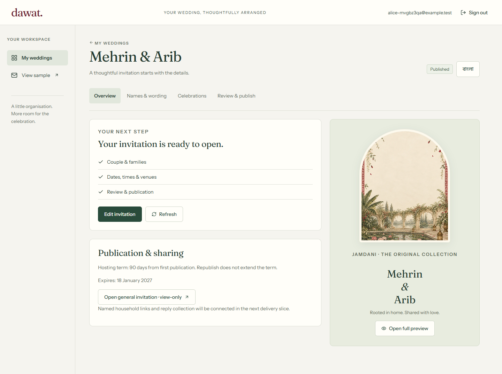
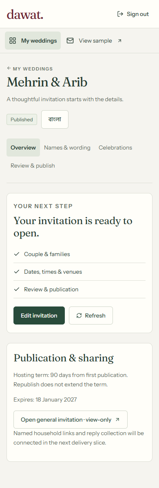
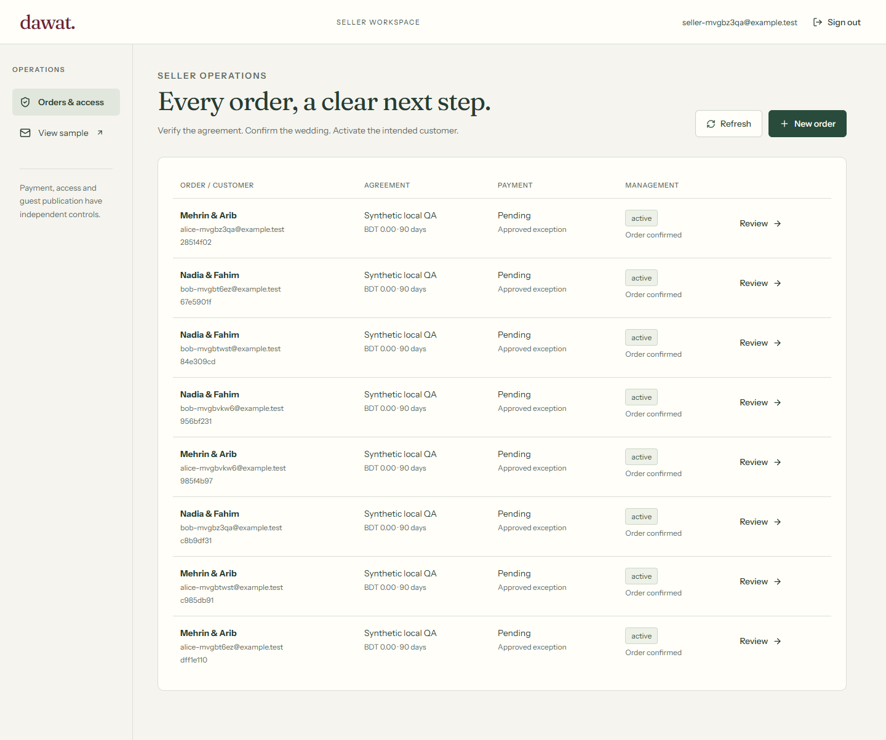

# Client backend foundation — implementation evidence

20 October 2026 · local development only. User requested backend/auth/wedding isolation and seller activation before dashboard expansion, preserving the existing invitation. User confirmed no hosted Supabase project exists and authorized local setup.

## Implemented

- Next server runtime and private request handling; development-only legacy adapter; production missing configuration fails closed.
- Running local Supabase Auth/PostgreSQL with email-code templates, generated database types and reproducible npm setup/bootstrap/type commands. Docker Desktop was started; an existing process on port 3000 was left untouched. App runs on **http://127.0.0.1:3100**.
- Verified email OTP, HttpOnly/SameSite cookies, proxy refresh, server user verification and safe return paths. Staff are controlled database records; both API and SQL require MFA AAL2.
- PostgreSQL tables/RLS for orders, payment evidence, weddings, membership, access grants, term entitlements, drafts, immutable publications and append-only audit. No browser direct writes; no application service-role client. Foreign/unverified/banned/deleted/inactive/expired access is denied.
- Seller manual order, payment amount/reference verification, explicit complimentary/test exception, separate confirmation/provisioning and activation, suspension/revocation and audit timeline. Order/wedding uniqueness, transaction locks, actor-bound replay keys and revisions. Intended email must already be verified; direct assignment rather than a claim/delivery flow.
- Compact client wedding list and grouped names/wording/events/review editor. Incomplete explicit saves, server acknowledgements, disabled editing during writes, unsaved-navigation warning, retained local edits on conflict with explicit server/local recovery and shared-renderer read-only preview.
- First publication starts the individually supplied term once. Publication snapshots are immutable; draft saves preserve live content. General URLs are view-only and include only explicitly selected events, filtered before HTML/RSC/JSON. Management suspension leaves guest visibility unchanged.
- Jamdani art/type/music/reveal/gallery renderer preserved. Production media uploads are unavailable pending actual processing/storage implementation; public sample still includes its fictional original photos.

## Verification actually performed

| Check | Result / boundary |
| --- | --- |
| `npm run typecheck` | Passed with types generated from the running local database. |
| `npm test` | **112 passed across 8 files**, including 18 PostgreSQL integration tests using PGlite with real roles/RLS/transactions, HTTP origin/JSON/cache/redirect checks and existing 82 template/product checks. |
| `npm run build` | Optimized Next server build passed; dynamic auth/admin/customer/public-resolution routes. Final source build verified. |
| Production runtime smoke | Passed on an owned temporary port 3101: login renders, unauthenticated wedding API is 401/no-store, legacy studio/operator redirect to protected routes, general invitation is 200/no-store without restricted event content. Temporary process stopped afterward. |
| `npm audit` during install | 0 reported vulnerabilities across 139 packages; not a complete security audit. |
| Clean SQL migration | Applied successfully to local Supabase PostgreSQL 17. Subsequent hardening definitions reapplied without resetting local data; clean-install SQL also rerun in PGlite. |
| Real local services | Email OTP captured in Mailpit, verified server cookies, TOTP enrollment/verification, seller role bootstrap and MFA denial before verification. No external email sent. |
| Actual two-customer HTTP run | Repeat-create replay, confirm/activate, cross-wedding 404 both directions, acknowledged save/stale 409, concurrent same-revision saves produce one 200/one 409, publish, no restricted venue in general HTML/RSC, no-store, cross-origin 403, suspend denying management while general link remains 200, then reactivate. |
| Browser | Headless Windows Edge, desktop 1440px and 320/390/768px; overflow checks passed, editor save survives refresh, native preview dialog opens/closes, guest cover opens deliberately and seller page renders; no page errors. These are desktop emulation widths, not physical phone qualification. |

Latest reproducible local run: `20 October 2026, 12:57 Asia/Dhaka`. Unique synthetic emails/orders remain in the local database. OTPs, authenticator secrets and session cookies are not saved to evidence. `web/scripts/verify-local.mjs` refuses non-loopback origins. Optional browser module/Edge requirement is in [run guide](../../web/README.md).

## Rendered evidence

The layout retains the established paper/forest/wine palette and display typography, with slim navigation, aligned rows and practical grouped forms. Additional inspiration references: [Orbix dashboard work](https://dribbble.com/orbixstudiodashboard), [Orbix SaaS practice](https://www.orbix.studio/services/saas-design), [wedding dashboard study](https://dribbble.com/shots/18362061-Wedding-Invitation-Dashboard), plus the existing [Pinterest/stationery board](../design/inspiration-board.md). Public page descriptions were consulted; no competitor assets or code were copied and no exhaustive new visual audit is claimed.

## Explicit remaining work

This is not Client V1 launch approval. Named households/allowances, encrypted recoverable credentials and scoped guest sessions, real RSVP/wishes, reports/corrections/CSV, photo processing/private object policies, claims/reassignment/outbox, all lifecycle controls, full BN/EN account/seller copy, staff policy/capacity hardening, hosted/staging tests, physical phones, performance/load, backups/restore/retention and commercial policy gates remain. Explicit save ships before autosave. Two stable existing event kinds are preserved rather than introducing an unqualified generic ten-event renderer.

No price, default commercial duration or retention period was invented. Synthetic orders carry explicit test terms. No gateway, deployment, paid resource, external message or GitHub push/PR was performed.
