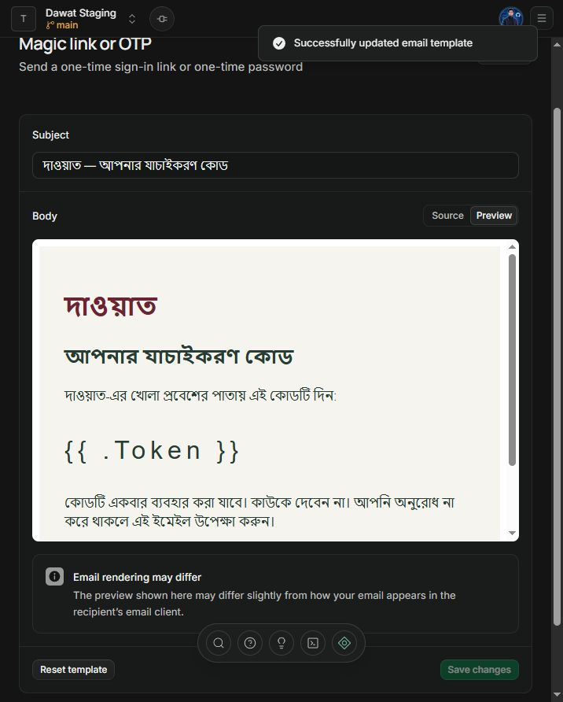

# Private media and Bangla-first product — 20 October 2026

Current slice preserves the original Jamdani gallery, cover, reveal, music and lightbox. It adds real photo storage/processing and makes the product default to Bengali with English secondary. This is implementation evidence, not full launch qualification.

## Behavior and boundaries

- Up to five active photo slots, including unexpired unfinished reservations. Sixth/concurrent excess rejected explicitly. Each upload ≤10 MiB and 20 million pixels; supported still JPEG/PNG/WebP, HEIC conversion guidance. Actual sharp decode, EXIF orientation correction, no upscaling and EXIF/GPS/XMP removal. Only sanitized 480/960/1600 WebP derivatives persist in private Storage; original bytes stay in bounded memory.
- Owner gate/RLS before processing. Shared lease acquired before buffering; maximum four in-flight jobs across instances and one native decoder per Node process. Body timeout 30s, transform timeouts, 2-minute recoverable leases, fingerprint-bound retries and four attempts maximum. Ready only after all objects and transactional acknowledgement; uncertain failures retain possibly committed output. Initial protective daily/history limits are explicit, not commercial promises.
- Browser/anonymous direct Storage operations denied by a restrictive dedicated-bucket policy. Only the isolated server processor uses a secret; ordinary data queries retain session RLS. Owner/general/household image proxies reauthorize every request, enforce live publication references and return private/no-store WebP. No public bucket or guest-visible signed object URLs. Revocation stops future scoped reads; already downloaded images cannot be recalled.
- Draft and immutable-version triggers reject foreign/unready/removed/duplicate/external image references. Removing from the draft/library preserves media pinned by retained publications. A delayed, bounded cleanup command handles abandoned attempts without collecting publication references; scheduling/monitoring and retention policy remain deployment work.
- Bangla-first root language, login/MFA, client/seller/household copy, statuses, relevant dates/counts, photo controls and OTP templates; English switch preserves current form data. Bangla OTP digits normalize before submission. Customer-entered names/messages remain unchanged. Management and template renderers retain their existing layout/logic; fresh rendered media/device review is still pending.

## Verification

Latest login loading regression: **173 tests / 15 files** and optimized build pass after adding bounded JSON request/header/body waits, no automatic mutation replay and malformed-success handling. Login's collapsing top margin is contained with flow-root. Port 3100 now runs optimized production mode; all nine embedded JS/CSS resources return 200 (281,480 bytes total), no development HMR, active email form, anonymous dashboard 307 and invalid-email request 422. No fresh visual/interaction qualification is claimed while browser control is disabled.

**170 tests / 14 files**, TypeScript and optimized Next server build. Final checks, actual local HTTP/Storage verification and optimized runtime smoke all passed again after the per-process decoder concurrency change. Added real PostgreSQL/PGlite role tests for reservation replay, sixth/expired/cancelled slots, cross-wedding reads/writes, direct readiness forgery, restrictive Storage policy under a broad unrelated permissive policy, foreign/pending/duplicate/external references, lease/fingerprint/object prerequisites, retries/rejection, shared concurrency, suspended-owner completion, publication retention and cleanup eligibility.

Real sharp tests verify orientation, stripped metadata, responsive dimensions, tiny-image no-upscale, corrupt/HTML/SVG/unsupported file rejection, byte/pixel bombs and process decode concurrency/retry. UI transport tests verify no insertion before server ack, same reservation/file on uncertain retry, no sixth photo or lost identities, default Bengali and English-switch field preservation, Bengali OTP digits and actionable errors. Existing invitation/regression checks still pass.

Actual local **Supabase Auth/PostgreSQL/Storage + HTTP** proof passed on `http://127.0.0.1:3102`: two customers/seller MFA, five concurrent reservations, sixth denial, SVG disguised as JPEG rejected, five real uploads processed, orientation and EXIF absence checked on returned WebP, cross-wedding upload/read denial, private object protection, named guest image reads and revocation, original RSVP/wishes/isolation flow, and retained published photo after draft/library removal. Synthetic accounts remain only in the offline test stack.

Optimized runtime smoke passed Bengali default HTML/login/order, pending-email gate without sending mail, unauthenticated media denial, private cache/referrer headers, foreign-origin rejection and invalid hosted guest credential. Dependency audit reports zero vulnerabilities after selecting sharp 0.35.5. Browser control became disabled; no fresh rendered media screenshots, Edge media-flow or physical-phone qualification are claimed.

## Hosted staging

Connected Supabase plugin verified **Dawat Staging**, `zztiestaqjbsbjuzmbqp`, Mumbai/free. Applied media migration and aligned migration history to source version `202610200003`; all three repository versions match. Audit: `bucket_public=false`, zero public tables without RLS, anonymous and authenticated browser roles cannot execute `process_media`.

`web/supabase/tests/hosted_media_smoke.sql` passed in the actual hosted database and locally using normal roles. It verifies five-slot limits, tenancy, direct Storage denial, trusted processing, pinned publication references and guest-photo revocation, with **all synthetic rows rolled back**. The SQL proof uses synthetic Storage object metadata, not actual hosted image bytes. Actual object decode/upload/delivery was verified offline; hosted processor credentials and authenticated hosted object flow remain pending. Do not rerun the media migration.

Security advisor flags intentional scoped SECURITY DEFINER RPCs and deny-all private tables. This is reviewed as the narrow authorization design, with role tests; it is not a claim of zero advisor notices. [Anonymous function advisory](https://supabase.com/docs/guides/database/database-linter?lint=0028_anon_security_definer_function_executable), [authenticated function advisory](https://supabase.com/docs/guides/database/database-linter?lint=0029_authenticated_security_definer_function_executable), [private deny-all RLS notice](https://supabase.com/docs/guides/database/database-linter?lint=0008_rls_enabled_no_policy).

## SMTP and pending handoff

**Delivery update:** after correcting the Google App Password, hosted Auth returned HTTP 200 for an OTP request and the user confirmed receipt. Enabled the email login gate in selected and saved hosted configuration; the running port-3100 login page returns HTTP 200 with the Bangla email form and no pending-setup notice. Private OTP entry and successful hosted session/dashboard access still require user verification. The earlier 535 failure below is historical; SMTP receipt is now confirmed.

User changed shared SMTP sender to `valtube101@gmail.com`; Gmail host/465 and credentials saved privately. Bengali-first signup and sign-in code templates saved/previewed. Actual send failed; Auth logs confirm **535 5.7.8 Username and Password not accepted**. User screenshots now confirm Google 2-Step Verification is enabled and a `Dawat Staging` App Password entry exists; private transfer of its generated password to Supabase and saving the corrected SMTP configuration remain unconfirmed. Keep the email gate disabled until corrected credentials, actual receipt and OTP verification pass. Every client receives OTP at their own email; no per-client SMTP setup. No invitation emails or bulk guest messages are automated.

Remaining: private hosted processor key, hosted object/app proof, corrected SMTP/delivery, hosted seller bootstrap/public app deployment, fresh responsive/phone/accessibility/performance/load review, cleanup scheduling/monitoring, full retention/object/key restore drill, manual corrections/CSV/outbox and commercial policies. See [run guide](../../web/README.md), [task tracker](../../task.md).
