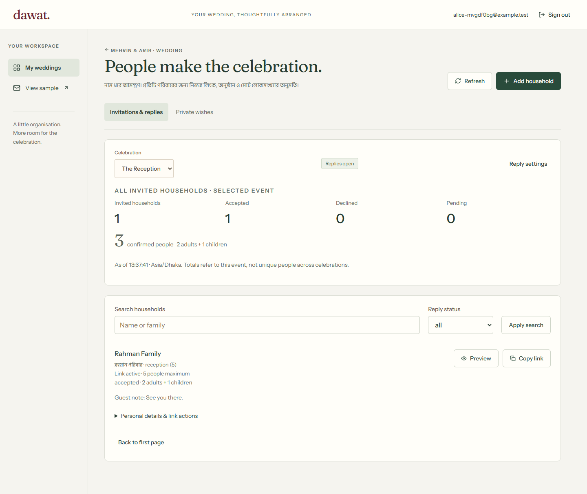
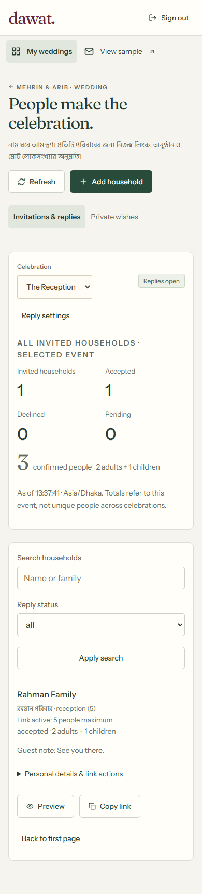
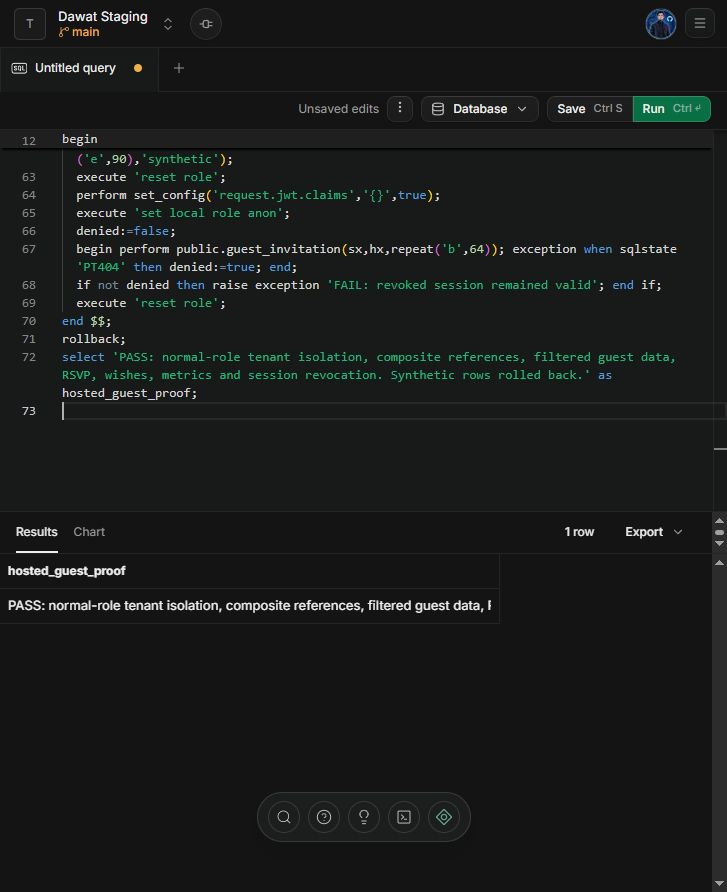
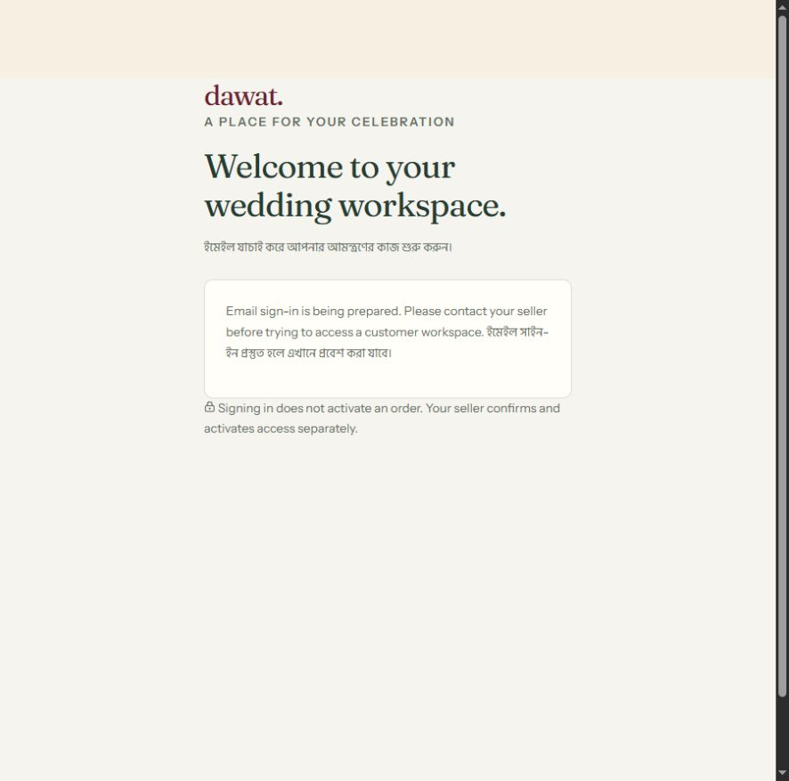

# Named guest delivery — 20 October 2026

Implemented around the existing Jamdani invitation: named household/event allowances and host-only notes, read-only personal preview, stable encrypted personal links with explicit replacement/revocation, scoped sessions, real RSVP/edit/private wishes and event reports. The shared cover, illustrated sections, gallery, deliberate opening, music and Bangla/English guest UI are preserved. This checkpoint is not full commercial launch acceptance.

## Verified behavior

- **143 Vitest tests / 11 files**, strict TypeScript and optimized server build. PostgreSQL integration uses normal authenticated/anonymous roles through PGlite. New tests cover tenant and household credentials, direct private-table denial, unauthorized events, allowance/deadline/policy/overlay conflicts, all-or-nothing answers, retry-key/body conflicts, duplicate writes, expiry, suspension independence, stable recopy, rotation/revocation/history and wishes independent of attendance.
- Actual local Supabase/Auth/PostgreSQL HTTP workflow with two synthetic customers, seller OTP/MFA and two isolated weddings. Named links are stable on recopy; server replies/wishes persist and reports match; foreign owners cannot preview/read/change another wedding. Local verification leaves synthetic fixtures only in the offline stack.
- Actual Edge automation: personal URL exchanges to a canonical URL without the raw credential; sealed cover renders before reply forms; Bangla numeric party counts save through the real API; wishes receive server receipts; distinct household tabs retain independent names/scopes; an independent session reads the persisted reply; rotate/revoke invalidates earlier sessions and retains answers. Compact management screenshots at desktop and 390px were inspected.
- Original response UI tests confirm no success before server acknowledgment, failed/uncertain submits retain typed values and stable retry keys, conflicts remain visible and closed policies prevent new responses. Foreground refresh retains last successful results, rejects out-of-order fetches and backs off after failures.
- Two concurrent-transport regressions confirm that a delayed background read cannot replace a newer acknowledged answer, and that an older successful write receipt cannot replace a still-newer server answer. Monotonic response/household/policy revisions protect guest presentation from these reordered requests.

## Hosted database proof

User created **Dawat Staging**, project `zztiestaqjbsbjuzmbqp`, free Mumbai region, and explicitly approved the two prepared migrations. Applied once in a transaction with migration history. The project audit returned both migration versions, **17 public tables and zero public tables without RLS**, an available narrow guest command and no anonymous direct response select grant.

`web/supabase/tests/hosted_guest_smoke.sql` passed both locally and in the actual hosted SQL editor. It creates synthetic users/weddings/households only inside a rolled-back transaction and switches to normal authenticated/anonymous roles. Assertions cover cross-wedding denial, host-only note and uninvited-event filtering, composite tenancy constraints, scoped RSVP/wishes/event counts and revocation of an already exchanged session. No synthetic users/data remain from this hosted proof and no external email was sent. Public REST checks also denied anonymous direct household/response/wish reads and an invalid guest session.

The app uses the hosted URL and publishable key with an independent encrypted-token key ring; no service-role key. Offline configuration is preserved separately. **SMTP is absent and explicitly deferred by the user**: hosted customer sign-in is disabled with truthful setup-pending UI/API. Hosted database verification does not qualify real outbound OTP delivery or publicly deploy the frontend.

After switching, a fresh optimized build and all 143 tests passed. The actual production server on a temporary owned port passed HTTP smoke checks for the SMTP gate (503 without sending mail), unauthenticated workspace denial, invalid hosted guest credential rejection, no-store/referrer headers, foreign-origin rejection and legacy redirects. The local synthetic signup script also correctly refused to run while hosted configuration was selected. Browser inspection on port 3100 confirmed setup-pending login.

## Evidence

## Remaining gates

Custom SMTP/code templates and real delivery tests, hosted seller bootstrap, public server deployment, media processing, manual host corrections/CSV, claims/outbox, retention cleanup, complete management localization, actual Android/iPhone flow/listening, current load/accessibility/performance measures, deployment log/token redaction, independent key/database restore drills and commercial policies remain. Existing database-backed valid-link/write throttles are not a claim of distributed abuse/load qualification. Owner sessions and household bearer credentials remain distinct; forwarding a link grants that household access. See [task tracker](../../task.md) and [run guide](../../web/README.md).
