# Customer-first onboarding blueprint · 27 October 2026

Status: proposed implementation blueprint informed by the connected three-role audit. Findings and final executed/retested scope are recorded separately in the root validation report. Preserve Claude's current design system and the existing Supabase authority boundaries. Do not deploy intermediate iterations; release once after the agreed batch is complete and validated.

## Product promise and policy boundaries

Digital wedding invitations, customer editing, named family links and replies. Published prices: Normal৳500, Premium৳750, Customized৳1500. Custom design is discussed on WhatsApp. Manual bKash Personal01606092143; genuine transfer matching by an admin precedes activation. No gateway or automatic guest WhatsApp/email sending is implied. The rehearsal's90-day term is test data, not a newly imposed production policy.

Standard purchases currently require a seller quote because term/scope/other conditions are agreed per order. Do not silently skip agreement or invent hosting/delivery/refund promises. A later direct standard checkout depends on the owner defining those standard terms first.

## Journey and navigation contract

Public browsing never requires login. The chosen template and return destination survive OTP. After a request exists, its stable request ID is the canonical resume context; `?template=` is initial intent, not a command to reopen a blank form on every refresh. A new request is an explicit action. The primary portal entry routes an account with an unfinished purchase to its order status; an active customer to the intended wedding; an account with several weddings to its list. Existing issued URLs continue working.

```mermaid
flowchart LR
  A[Browse and preview] --> B[Own-email verification]
  B --> C[Request saved]
  C -->|Admin quote| D[Review exact terms]
  D -->|Buyer accepts| E[Order ready for payment]
  E --> F[TrxID submitted]
  F -->|Admin matches transfer| G[Payment verified]
  G -->|Confirm then activate| H[Private customer workspace]
  H --> I[Names and events]
  I --> J[Preview and publish]
  J --> K[Add families]
  K --> L[Named links and manual sharing]
  L --> M[Replies and guest management]
```

## Customer state-by-state screen requirements

Every screen states: what has happened, who acts next, the primary next action, the saved order reference, and how to recover. Keep one dominant CTA. Show real status and last successful check; preserve input after validation/network errors. Support links include the exact reference. Do not promise a response time that the owner has not agreed to deliver.

| State | Main message / next actor | Main action | Recovery and forbidden confusion |
| --- | --- | --- | --- |
| Choosing | See the actual design, included features and published price | Choose this design | Preview freely; clear custom-discussion path |
| Email verification | Code went to this email; design preserved | Verify and continue | Change email, resend cooldown, readable expired/invalid-code error |
| Request draft | Name and event needs; date may be unknown | Send request | Back/reload protection or recoverable draft; no payment yet |
| Request saved | We have your request; team prepares terms | View order status | Reload resumes this request; no repeated blank form or duplicate submission |
| Quote ready | Exact design, price, term and scope | Accept these terms | Cancellation/contact path; changed quote requires rereview |
| Accepted | Agreement saved; team prepares the order | Check status | Clear waiting owner; no premature payment fields |
| Payment ready | bKash Personal, amount, receiving number and own reference | Submit sender and SMS TrxID | Copy each value; order reference is not the TrxID; errors retain entered fields |
| Evidence pending | Details received; team checks real funds | Check status | Explicitly do not pay again; still not active |
| Evidence rejected | Explain the mismatch and what to correct | Correct transaction details | Reuse the original transfer when appropriate; do not imply another transfer is needed |
| Verified / activating | Payment checked; customer access being prepared | Check status | Distinct paid and active states; avoid generic locked dashboard dead end |
| Active | Your private invitation workspace is ready for this email | Open your workspace | Copy the dedicated authenticated entry, clearly separate guest URLs |
| Draft invitation | Show saved progress and next required task | Continue setup | Acknowledged saves, retry/conflict recovery; no false publication state |
| Published | Guests see this version; draft changes remain private | Add families / share named links | Review before republish; hosting term starts once, not on every edit |

## Admin workbench and activation handoff

Keep request, quote, accepted order and payment evidence tied to one identity across navigation. Open the exact order from its request; show name, verified email, design, published price, term, request/order reference and current status together. Do not make the admin re-find a customer among unrelated orders.

Review evidence against actual receiving-account records: provider, amount, sender, TrxID and time/context. A submitted string or screenshot alone does not prove funds. Record a meaningful review reason. Verification, order confirmation and activation retain separate controls and audit entries. Do not weaken MFA or intended-customer checks to reduce clicks.

Activation success must leave a persistent handoff card, not just a transient generic dashboard anchor: intended email, dedicated private workspace URL, copy control, sign-in explanation, next setup step, and honest “copied; no message sent” feedback. The same handoff remains available after reload by opening the order. Wrong accounts stay denied. Admin preview is not customer impersonation.

## First-use invitation setup

1. Welcome with the purchased design and a single next step. Keep the existing compact overview/editor/guest destinations.
2. Couple/family names and invitation wording. Show which language fields are required; optional advanced wording stays collapsed.
3. Ask which celebrations actually exist. Require date/time/venue only for selected celebrations; allow a second celebration without forcing every buyer to have two.
4. Optional photos, maximum five, with visible upload/saved/retry states. Do not gate a usable invitation on photos.
5. Preview the selected artwork and actual saved names/events, then an explicit publish action. Explain draft versus guest-visible state once, near the relevant controls.
6. Success leads directly to adding families; private workspace and public/named links remain clearly labelled.

The wizard must be resumable from persisted setup state and must not repeatedly block experienced hosts. Current authorization, draft revision and publication semantics are the source of truth.

## Operating50 families with low effort

**Immediate single-entry improvements:** default event scope from the explicitly selected report/event when sensible; require review of the scope; a “Save and add another” action; preserve useful defaults and failed input; warn before closing a dirty modal; concise saved count and direct route to the new row/link. Keep duplicate family names possible, with a disambiguating note/ID.

**Planned batch entry:** paste/import a bounded list of names, adult/child allowance and event scope. Show a dry-run editable table before committing; flag invalid rows and possible duplicates without silently dropping data. Optional notes stay private. Do not require collecting WhatsApp/email addresses for a link-based invitation. A batch API must enforce the same tenant, quota, scope, revision and idempotency rules as the existing single-family command; direct browser database writes are not acceptable. Partial failure/retry needs a receipt and exact saved/failed counts.

**List and filters:** count families separately from people; show selected event and attendance basis; preserve search/status/page through reload and drilldown;25-row pagination has clear previous/next state. Avoid adding totals across overlapping events as a unique-people count. Duplicate and long Bangla names must remain identifiable and accessible.

**Links/sharing:** generate and recopy stable named links; clear copy feedback; direct preview; rotation/revocation remain deliberate and retain replies. Preparing/copying a link never marks it sent/delivered. A manual share composer may prepare wording and a named URL but never sends automatically. Bulk link preparation/export is separate from actual delivery. Guest bearer URLs must not be placed in tracked logs or admin/customer URLs.

## Validation and release batches

| Batch | Deliverable | Pass gate |
| --- | --- | --- |
| A · Resume and handoff | Canonical request resume; clear pending/activation next step; exact seller order navigation; persistent dedicated-link card | Fresh buyer deep-link OTP → request → reload without blank duplicate form; seller activates same order; assigned buyer reopens exact link; wrong account denied |
| B · Fast first-use | Resumable setup with actual events and saved state; clear publication handoff | New buyer reaches usable preview/publication without developer guidance; failed save/refresh preserve correct state |
| C ·50-family efficiency | Fast single entry, dirty-modal protection, durable filters; then bounded batch entry/link workflow | Exactly50 persisted families and50 valid named links; representative UI work plus API persistence checks; scoped replies/over-allowance/cross-family/revocation proofs |
| D · One release | Consolidated report, regression suite, current-source build, browser walkthrough and one deployment | No unresolved critical money/access/privacy/data-loss issue in the executed scope; clear unexecuted cases; postrelease smoke once |

The final report maps each observed issue to a batch and states which remedies were implemented versus remain proposals. Physical-device use and real bKash settlement remain owner-operated checks, not simulated pass claims. Preserve existing guest links, customer records, provider budget and Claude's visual work.
