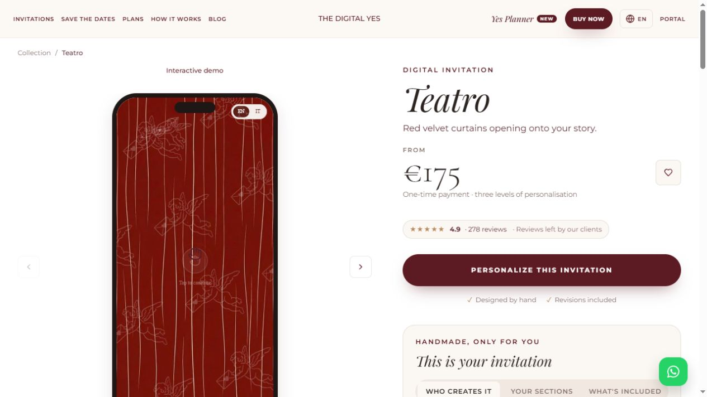

# Local reference evidence

Captured on **19 October 2026, Asia/Dhaka** through public browser UI. These files preserve reference research, not production artwork/code or proof of backend delivery.

- [Page index](page-index.md): 106 URL-to-local-text entries (88 product/template pages, 18 supporting pages).
- [Machine-readable index](page-index.json): URL, snapshot path, heading, captured text length and any observed embedded frame title/URL.
- `pages/*.ax.txt`: visible accessibility-text snapshots. They may include public testimonials/demo names and do not necessarily contain every later-loaded embedded frame.
- The selected-state captures below add forms/configuration/planner context. A PNG is a viewport screenshot, not a full-page image or video.
- Fictional preview values only; no real customer contact/upload/payment/RSVP was submitted.
- Original animated scene/media/source files were not downloaded or copied for reuse.

## Later user-supplied dashboard video

The user subsequently forwarded a vendor dashboard recording. It is archived separately from the public-browser captures: [source and contact sheets](vendor-dashboard-video/README.md), [detailed findings](../specs/vendor-dashboard-video-review.md). This establishes recorded host UI, not authenticated access or tested delete/print behavior. The recording includes names/messages/photos and is local reference evidence, not reusable product media. The public-page index remains at 106 routes and does not count video frames as new pages.

## Selected screens

Later focused live-preview study: [Teatro opening/scroll/photo/scratch/conditional-RSVP walkthrough](guest-preview-walkthrough/README.md), with six additional screenshots and a text snapshot. Its findings and limits are separate from the original 106-route archive. No competitor media assets were copied into our product.

| Screen | Screenshot | Text |
|---|---|---|
| TDY home | [PNG](tdy-home.png) | [AX](tdy-home.ax.txt) |
| TDY Teatro product | [PNG](tdy-product-teatro.png) | [AX](tdy-product-teatro.ax.txt) |
| Plan choice | [PNG](tdy-plan-chooser.png) | [AX](tdy-plan-chooser.ax.txt) |
| Order summary | [PNG](tdy-order-summary.png) | [AX](tdy-order-summary.ax.txt) |
| Add-ons | [PNG](tdy-order-addons.png) | [AX](tdy-order-addons.ax.txt) |
| Code/credit entry | [PNG](tdy-credit-entry.png) | [AX](tdy-credit-entry.ax.txt) |
| Save the Date form | [PNG](tdy-save-the-date-order.png) | [AX](tdy-save-the-date-order.ax.txt) |
| 3D collection | [PNG](tdy-3d-collection.png) | [AX](tdy-3d-collection.ax.txt) |
| Portal login | [PNG](tdy-portal-login.png) | [AX](tdy-portal-login.ax.txt) |
| Gift CTA entry attempt, no purchase/form verified | [PNG](tdy-gift-card-order.png) | [AX](tdy-gift-card-order.ax.txt) |
| Planner summary | [PNG](tdy-planner-summary.png) | [AX](tdy-planner-summary.ax.txt) |
| Planner budget | [PNG](tdy-planner-budget.png) | [AX](tdy-planner-budget.ax.txt) |
| Planner guests | [PNG](tdy-planner-guests.png) | [AX](tdy-planner-guests.ax.txt) |
| Planner tasks | [PNG](tdy-planner-tasks.png) | [AX](tdy-planner-tasks.ax.txt) |
| Planner binder | [PNG](tdy-planner-binder.png) | [AX](tdy-planner-binder.ax.txt) |
| Planner families | [PNG](tdy-planner-families.png) | [AX](tdy-planner-families.ax.txt) |
| Planner tables | [PNG](tdy-planner-tables.png) | [AX](tdy-planner-tables.ax.txt) |
| Planner catering | [PNG](tdy-planner-catering.png) | [AX](tdy-planner-catering.ax.txt) |
| e-Nimontron home | [PNG](en-home.png) | [AX](en-home.ax.txt) |
| Wedding form | [PNG](en-customizer.png) | [AX](en-customizer.ax.txt) |
| Fictional preview | [PNG](en-preview.png) | [AX](en-preview.ax.txt) |
| Checkout contact | [PNG](en-checkout-contact.png) | [AX](en-checkout-contact.ax.txt) |
| Checkout email mode | — | [AX](en-checkout-email.ax.txt) |

## Visual anchors

### Product presentation reference

### Local personalized-preview reference

Do not use these screenshots in our live product gallery or claim the depicted designs are ours. For actual build assets follow [asset production](../specs/asset-manifest.md).
